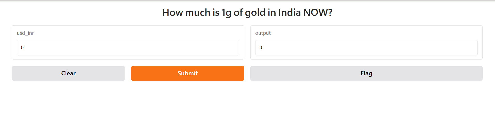

# 🪙 Gold Rate Prediction in India

A simple **Machine Learning + Gradio** application that predicts the current price of **1 gram of gold in India** based on the USD/INR exchange rate.

The application uses a trained regression model along with a scaler to transform the input before generating the predicted gold rate.

## 🚀 Features

- Predicts the price of **1g of gold in India**
- Uses a pre-trained regression model
- Uses a saved scaler for input preprocessing
- Simple and interactive **Gradio** interface
- Returns the predicted gold rate rounded to 2 decimal places
- Can be shared publicly using Gradio's `share=True` option

## 🛠️ Technologies Used

- **Python**
- **NumPy**
- **Scikit-learn**
- **Pickle**
- **Gradio**
- Machine Learning Regression

## 📁 Project Structure

```
gold-rate-prediction/
│
├── app.py
├── regressor.pkl
├── scaler.pkl
├── requirements.txt
└── README.md
```

### File Description

| File | Description |
| --- | --- |
| `app.py` | Main Gradio application |
| `regressor.pkl` | Pre-trained regression model |
| `scaler.pkl` | Feature scaler used during model training |
| `requirements.txt` | Python dependencies |
| `README.md` | Project documentation |

## ⚙️ How It Works

The application takes the **USD to INR exchange rate** as input.

The input goes through the following process:

```
USD/INR Exchange Rate
        ↓
     Scaler
        ↓
Regression Model
        ↓
Predicted Gold Rate
        ↓
    Rounded Value
```

The prediction function performs the following steps:

1. Converts the user input into a NumPy array.
2. Reshapes the input into the format expected by the scaler.
3. Scales the input using `scaler.pkl`.
4. Passes the scaled value to the regression model.
5. Converts the prediction into a Python `float`.
6. Rounds the result to 2 decimal places.

## 💻 Installation

### 1\. Clone the repository

```
git clone https://github.com/karthikanirose1016-sketch/Gold_Rate_Prediction_in_India.git

cd Gold_Rate_Prediction_in_India
```

### 2\. Create a virtual environment

```
python -m venv venv
```

Activate it:

**Windows:**

```
venv\Scripts\activate
```

**Linux/macOS:**

```
source venv/bin/activate
```

### 3\. Install dependencies

```
pip install -r requirements.txt
```

If you don't have a `requirements.txt` file, install the packages manually:

```
pip install gradio numpy scikit-learn
```

## ▶️ Run the Application

Run the Python application:

```
python app.py
```

Gradio will start a local web interface.

Because the application uses:

```
demo.launch(share=True)
```

Gradio can also generate a temporary public sharing URL.

## 🧮 Example

Suppose the USD/INR exchange rate is entered into the application:

```
USD/INR: 83.50
```

The application will:

```
83.50
  ↓
Scale input
  ↓
Regression model
  ↓
Gold price prediction
  ↓
₹XXXX.XX
```

> **Note:** The exact prediction depends on the regression model stored in `regressor.pkl` and the preprocessing stored in `scaler.pkl`.

## 📤 Output

**Output:**

* Predicted Gold Rate for 1 gram in India


## 🤖 Machine Learning Model

This project uses a pre-trained regression model saved using Python's `pickle` module.

The model is loaded with:

```
model = pickle.load(open("regressor.pkl", "rb"))
```

The scaler is loaded with:

```
scaler = pickle.load(open("scaler.pkl", "rb"))
```

The input is scaled before prediction:

```
scaled_input = scaler.transform(
    np.array(usd_inr).reshape(1, -1)
)
```

The model then generates the prediction:

```
prediction = model.predict(scaled_input)[0]
```

## 📦 Requirements

A basic `requirements.txt` can contain:

```
gradio
numpy
scikit-learn
```

Make sure the versions of packages used to **train the model** are compatible with the versions used to run the application, especially when loading `.pkl` files.

## ⚠️ Disclaimer

This project is intended for **educational and demonstration purposes**.

The predicted gold price is generated by a machine learning model and should **not be considered a live or official gold price**. Actual gold prices can vary based on factors such as market conditions, purity, taxes, making charges, location, and other economic factors.

## 🔮 Future Improvements

Possible improvements include:

- Add live USD/INR exchange-rate data
- Add live gold-price data
- Support different gold purities such as 22K and 24K
- Add historical gold-price charts
- Improve the regression model with additional features
- Deploy the application permanently
- Add prediction confidence/error metrics
- Add automatic daily data updates

## 👨‍💻 Author

**Karthika**

Data Analysis & Data Science
